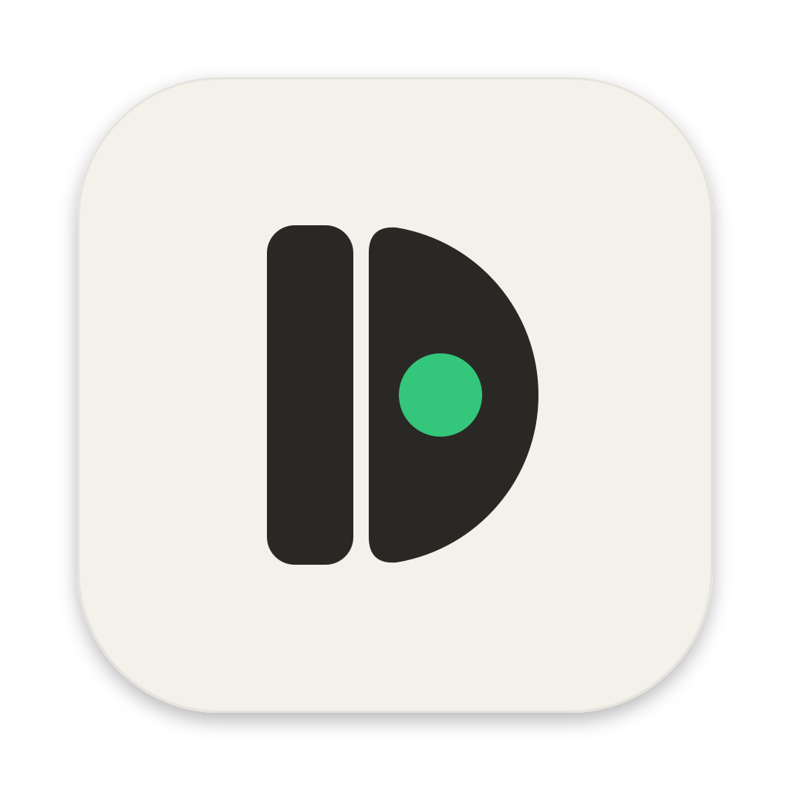
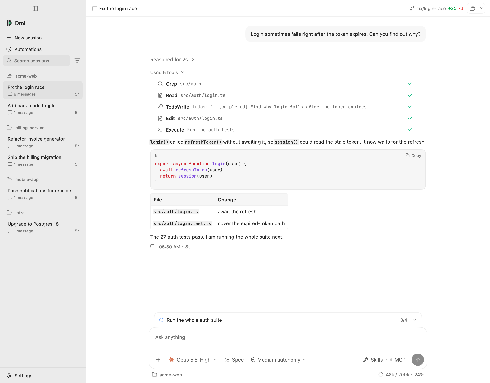

<p align="center">
  
</p>

# Droi

[](LICENSE)
[](https://go.dev/)
[](https://mygo.egoist.dev)
[](https://expo.dev/)
[](https://github.com/kkkk2323/droi/releases/latest)

A native macOS, Windows and iPhone client for the [Factory Droid](https://docs.factory.ai) coding agent.

Droi is a thin Client of `droid daemon`, the Daemon built into the Droid CLI. It shows and drives the same Sessions as the CLI with the same login, Skills, MCP Servers and settings. Turn on Remote Access to continue a Session from your iPhone, or point the desktop window at `droi host` on another machine.



## Highlights

- **Unified Sessions & Worktrees**: every Session the Daemon knows (including Sessions started in the `droid` CLI), grouped by Workspace or ordered by time and unread state, with one-click Git Worktree isolation.
- **Full Agent Surface**: streaming replies, reasoning, tool calls and diffs, Script runs, subagent trails, mid-turn permission prompts, non-blocking Queued Questions (`droid 1.1`), Automations, Loops and native Mermaid diagrams.
- **Per-Session & Workspace Controls**: model picker, reasoning effort, autonomy and tool mode (`Direct`, `Both`, `Script`), slash commands, Skills, MCP Servers, Workspace Git status and "Open in" your editor.
- **Cross-Device & Multi-Host**: scan a QR code in **Settings → Remote Access** to pair the iPhone Phone App, or paste a pairing link in **Settings → Computer** to follow a headless `droi host` on Linux, macOS or Windows. Your Factory credentials never leave the Host computer.
- **Automatic Memory**: Droi summarizes finished Sessions in the background and injects a concise Memory Summary into new Sessions through its own MCP Server and `SessionStart` hook. Ask Droid to remember or correct something and it records a Memory Note.
- **Extensible Go Library**: build custom distributions on top of `pkg/droiapp` and `pkg/extension` with your own brand, pre-approved MCP servers, custom tool views, dashboards and Settings tabs.

## Performance

The desktop app is written in Go on [MyGo](https://mygo.egoist.dev)'s native UI: no Electron, no webview and no Node at runtime.

| Metric | Native (MyGo) | Electron |
|---|---|---|
| Launch to Session list | 0.95 s | 2.9 s |
| Idle memory | 103 MB | 526 MB |

Measurement methodology: [apps/native/docs/performance.md](./apps/native/docs/performance.md).

## Quickstart

1. **Install the [Droid CLI](https://docs.factory.ai/droid-cli/quickstart.md)** and check that `droid` runs on `PATH` (or in `~/.local/bin` on macOS/Linux, `%USERPROFILE%\bin` on Windows):
   ```bash
   curl -fsSL https://app.factory.ai/cli | sh            # macOS / Linux
   irm https://app.factory.ai/cli/windows | iex          # Windows (PowerShell)
   ```
2. **Install Droi** from the [latest Release](https://github.com/kkkk2323/droi/releases/latest):
   - **macOS** (Apple silicon & Intel): open `droi-<version>.dmg` and drag **Droi** to Applications. Since the build is not notarized with an Apple Developer ID, clear quarantine if macOS blocks first launch:
     ```bash
     xattr -cr /Applications/Droi.app
     ```
   - **Windows 10/11 (x64)**: run `droi-setup-<version>-amd64.exe` (installs per-user without administrator rights; if SmartScreen prompts, choose **More info → Run anyway**).
   - **Linux (`x64` / `arm64`, headless Host)**: install `droi-<version>-linux-<arch>.tar.gz` and run `droi host` ([setup guide](./apps/native/README.md#droi-host-on-linux)).
3. **Sign in**: if `droid` is already signed in, Droi opens straight to your Sessions. Otherwise, sign in with Factory in the window (shared with the `droid` CLI) or paste a `FACTORY_API_KEY`. Additional Factory accounts can be added under **Settings → Account**.
4. **Optional (iPhone Phone App)**: build and install the Expo client on a connected iPhone with `pnpm install:phone`, enable **Settings → Remote Access** on your computer and scan the QR code.

Droi checks for signed delta updates every hour and restarts automatically once no Session is working ([how releases work](./apps/native/docs/releases.md)).

## How Droi Works with Factory Droid

Droi adds no agent runtime of its own. All file, shell and Git work happens inside `droid daemon`; Droi supervises the process and renders the conversations.

```
Desktop window (Go) ── Local token ───┐
                                      ├── Host Gateway ── droid-sdk-go ── droid daemon
Phone App / Remote ─── Pairing Token ─┘
```

- **Daemon (`droid daemon`)**: owns every Session, its transcript, Worktrees, Automations, Skills and MCP connections.
- **Host**: runs inside the desktop app (or standalone as `droi host`). It supervises the Daemon, shares the `droid` CLI login (and manages multi-account folders via `FACTORY_HOME_OVERRIDE`), attaches the Runtime Overlay for Memory and extensions, and runs the Gateway.
- **Gateway**: authenticates Clients with a per-launch local token or a Pairing Token, attaches the Host's Factory credential so secrets never travel to remote devices, and proxies the Daemon protocol over WebSocket.
- **Clients**: the native desktop window (`apps/native`) and the iPhone Phone App (`apps/mobile`). Neither holds conversation state; both speak the Daemon protocol through [droid-sdk-go](https://github.com/kkkk2323/droid-sdk-go) and `@droi/daemon-layer`.

Domain vocabulary is documented in [CONTEXT.md](./CONTEXT.md), and architecture decisions live in [docs/adr](./docs/adr).

## Built with Droid

Droi is built with Factory Droid. From the first commit in February 2026 through `v1.87.1`, the repository has **1,037 commits (633 of them co-authored by Droid) and 187 releases**:

```bash
git log --grep='factory-droid' --oneline
```

The repository is structured so Droid can plan, implement and verify changes end to end:

- **[AGENTS.md](./AGENTS.md) & [CLAUDE.md](./CLAUDE.md)** define the maintained packages, design system constraints and validation workflow.
- **[CONTEXT.md](./CONTEXT.md) & [docs/adr](./docs/adr)** record the ubiquitous language and 33 architecture decision records.
- **Skills in [.agents/skills](./.agents/skills)** guide TDD, bug diagnosis, code review and domain modeling.
- **Deterministic Fake Daemon testing ([ADR 0002](./docs/adr/0002-e2e-tests-run-the-client-against-a-fake-daemon.md))**: both Go view tests (`ui.NewTester`) and mobile Playwright E2E tests drive the real Clients against a scripted Fake Daemon from [droid-sdk-go](https://github.com/kkkk2323/droid-sdk-go) without needing a live Factory API key. Even the screenshot in this README is rendered from a Fake Daemon scenario:
  ```bash
  DROI_README_SHOTS=1 go test ./apps/native/internal/app -run TestReadmeScreenshots
  ```

## Development

Run all commands from the repository root:

| Command | Description |
|---------|-------------|
| `go run ./apps/native` | Run the desktop app (requires `droid` on `PATH`) |
| `go test ./apps/native/...` | Run Go unit tests and native view tests against the Fake Daemon |
| `go tool -modfile=apps/native/go.mod mygo build apps/native` | Build `Droi.app` / `.dmg` (or `-platform windows/amd64` for Windows) |
| `pnpm check` | Run format check, lint and TypeScript typecheck |
| `pnpm test` | Run TypeScript unit tests (vitest) |
| `pnpm test:e2e:phone` | Run Playwright E2E suite for the Phone App against the Fake Daemon |
| `pnpm install:phone` | Build a signed Release of the Phone App and install it on a connected iPhone |
| `FACTORY_API_KEY=... go test ./apps/native/pkg/host ./apps/native/pkg/gateway -run Live -v` | Run live integration tests against a real Daemon |

## Project Structure

```
apps/
├── native/                  # Desktop app & Host in Go on MyGo (macOS, Windows, Linux host)
│   ├── internal/app/        # Native window views and Fake Daemon view tests
│   ├── pkg/host/            # Daemon supervisor, CLI login, multi-account, Runtime Overlay
│   ├── pkg/gateway/         # Remote Access Gateway and Pairing Token verification
│   ├── pkg/droiapp/         # App-as-a-library entrypoint (ADR 0029)
│   ├── pkg/extension/       # Extension seams (Overlay, Pages, SettingsTabs, ToolViews)
│   └── pkg/...              # Public UI and protocol packages (sessionview, settingsview, kit, theme)
└── mobile/                  # iPhone Phone App (Expo SDK 57, React Native)
packages/
└── daemon-layer/            # Shared TypeScript Daemon connection and Session state layer
tests/
└── mobile/                  # Playwright E2E tests for the Phone App against the Fake Daemon
docs/
└── adr/                     # Architecture Decision Records (ADR 0001–0033)
```

More details on the native package layout and reference screen testing are in [apps/native/README.md](./apps/native/README.md).

## License

[MIT](LICENSE)
