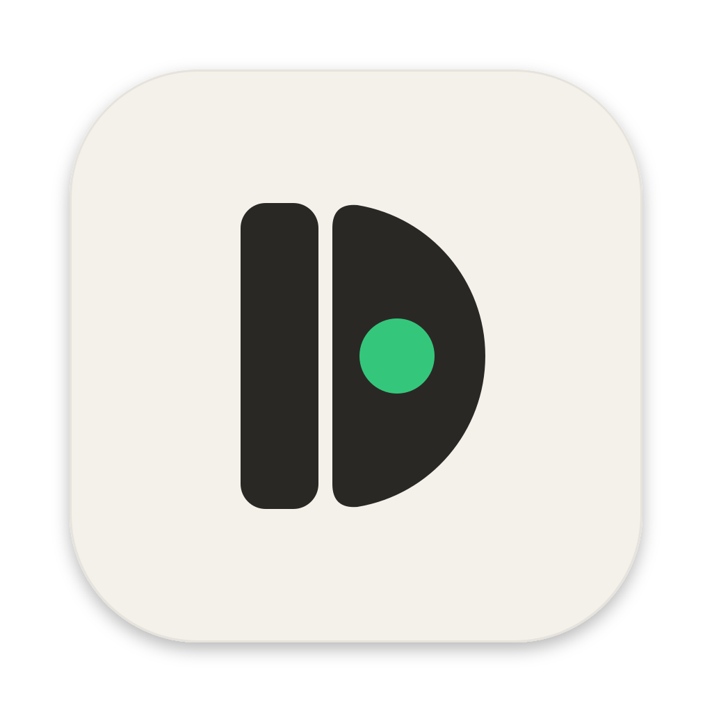
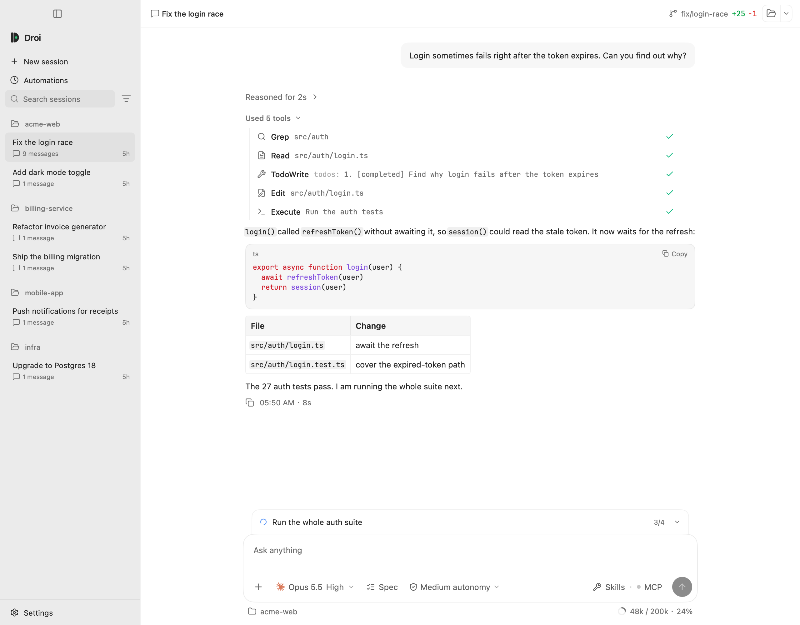

<p align="center">
  
</p>

# Droi

[](LICENSE)
[](https://go.dev/)
[](https://mygo.egoist.dev)
[](https://expo.dev/)
[](https://github.com/kkkk2323/droi/releases/latest)

A native Mac, Windows and iPhone app for the [Factory Droid](https://docs.factory.com) coding agent.

Droi is a Client of `droid daemon`, the Daemon in the Droid CLI. It shows and drives the same Sessions as the CLI, with the same login, Skills, MCP Servers and settings. Turn on Remote Access and you can carry on a Session from your iPhone.



## Quickstart

1. Install the [Droid CLI](https://docs.factory.com/droid-cli/quickstart.md) and check that `droid` runs:
   ```bash
   curl -fsSL https://app.factory.ai/cli | sh            # macOS
   irm https://app.factory.ai/cli/windows | iex          # Windows (PowerShell)
   ```
2. Download Droi from the [latest Release](https://github.com/kkkk2323/droi/releases/latest): `Droi <version>.dmg` for macOS, `Droi Setup <version> amd64.exe` for Windows. If the system refuses to open it, see [Install](#install).
3. Open Droi and sign in with Factory. If `droid` is already signed in, Droi opens straight away.
4. Click **New session**, pick a Workspace folder, type a task and send it. Droid starts working, and the reply streams into the window.
5. Optional: build the Phone App (`pnpm install:phone`), turn on **Settings → Remote Access** and scan the QR code with the phone.

## What it does

- **Every Session, one list**: all the Sessions the Daemon knows, grouped by Workspace, with search and sorting, including Sessions started from the `droid` CLI.
- **Full transcripts**: your messages, Droid's replies with code and tables, reasoning, tool calls with their results, Scripts, subagents and the task list.
- **Live turns**: watch the reply stream, queue the next message while Droid works (⌘↩ hands it to the running turn), cancel at any time.
- **Prompts**: allow or deny a tool call and answer Droid's questions. When a Session is open on the Mac and on the phone, both show the prompt and the first answer wins.
- **Per-Session settings**: model, reasoning effort, autonomy and tool mode (Direct, Both, Script), from the Daemon's own model list.
- **Magpie models**: with [Magpie](https://usemagpie.ai) running on this computer, its models join the model picker in a tab of their own, with no settings file to edit. Droi reads the gateway's model list and hands it to this computer's Daemon alone; the `droid` CLI keeps its own.
- **New Sessions**: in a recent Workspace, another folder, or a new folder of its own; paste or drop images into the message.
- **Around the Session**: slash commands, Skills and MCP Servers, the Workspace's Git changes, and "Open in" Finder or your editor.
- **Memory**: Droi keeps what Droid learns about you and your Workspaces (conventions, tool quirks, past failures) and gives it back in later Sessions.
- **Phone access**: turn on Remote Access, scan the QR code with the Phone App. The phone talks to the Gateway on your Mac; your Factory credentials never leave it.
- **Alerts**: a sound, a notification and an unread mark when a Session finishes or waits for you.
- **Updates itself**: it checks every hour, downloads only what changed, checks the signature, and restarts once no Session is working.
- **Local proxy support**: point the Daemon at a Factory API base URL such as a local `droid-proxy`.

## Performance

The Mac app is written in Go on [MyGo](https://mygo.egoist.dev)'s native UI, with no Electron and no webview. Compared with the Electron app it replaces, on our test Mac:

| | Native | Electron |
|---|---|---|
| Launch to the Session list | 0.95 s | 2.9 s |
| Memory when idle | 103 MB | 526 MB |

How we measured: [apps/native/docs/performance.md](./apps/native/docs/performance.md).

## Requirements

- macOS (one app for Apple silicon and Intel), or Windows 10 or 11 (x64); on Linux (x64 or arm64) only the windowless Host, `droi host` ([how](./apps/native/README.md#droi-host-on-linux))
- The [Droid CLI](https://docs.factory.ai) (`droid` on PATH, in `~/.local/bin`, or in `%USERPROFILE%\bin` on Windows)
- A Factory account: Droi shares its login with the `droid` CLI, and the Daemon runs as it

## Install

Download `Droi <version>.dmg` from the [latest Release](https://github.com/kkkk2323/droi/releases/latest) and drag Droi into Applications. The app is not signed with an Apple Developer certificate, so if macOS refuses to open it, run:

```bash
xattr -cr /Applications/Droi.app
```

On Windows, run `Droi Setup <version> amd64.exe` from the same Release. It installs Droi for your user only, with no administrator rights. The installer is not code-signed either: if SmartScreen stops it, choose **More info** → **Run anyway**.

When Droi opens, sign in with Factory (the same device-code login as `/login` in `droid`), or paste a Factory API key. Droi gives the login to the `droid` CLI, so the two share it; if `droid` is already signed in, Droi opens straight away. Under **Settings** → **Advanced** you can set a Factory API base URL (a local `droid-proxy`, say). `FACTORY_API_KEY` and `FACTORY_API_BASE_URL` in the environment are honoured too.

To use more than one Factory account, add them under **Settings** → **Account**. Each keeps its own login and shows its usage; all of them share your skills, droids, MCP servers, settings and sessions. Switching restarts the Daemon.

Droi keeps its settings, Memory and the Pairing Token in `~/Library/Application Support/Droi` (`%APPDATA%\Droi` on Windows), readable only by your user. It replaces the old Electron app in place: same bundle identifier and data folder, so your settings and paired phones carry over.

### The Phone App

The iPhone Client is built from source and installed on a connected iPhone with Xcode: `pnpm install:phone`. Then turn on **Settings → Remote Access** on the Mac and scan the QR code with the Phone App. See [apps/mobile/DEVICE-CHECKLIST.md](./apps/mobile/DEVICE-CHECKLIST.md) for what to try on the device.

## How Droi uses Factory Droid

Droi adds no agent of its own. All the work is done by Droid; Droi gives it a window.

- **The Daemon**: Droi starts `droid daemon` from the Droid CLI and talks to it over the Daemon's own protocol through [droid-sdk-go](https://github.com/kkkk2323/droid-sdk-go), a Go SDK for the Daemon. The Daemon owns every Session, so Sessions started in the CLI show up in Droi and the other way round.
- **The login**: Droi hands its sign-in to the `droid` CLI, so both share one Factory login. More accounts get their own folder through `FACTORY_HOME_OVERRIDE` and still share your Skills, droids, MCP Servers, settings and Sessions.
- **Droid's features**: the model list, reasoning effort, autonomy and tool mode come from the Daemon. Slash commands, Skills, MCP Servers, tool permission prompts, Droid's questions, Scripts, subagents and the task list all appear in the window.
- **Memory**: Droi's own binary runs as an MCP Server for Droid, and Droid hooks (`PreCompact`, `SessionEnd`) ask it to save what the Session taught. Later Sessions get those facts back.
- **Factory API base URL**: Droi passes `FACTORY_API_BASE_URL` to the Daemon, so you can route Droid's traffic through a local proxy.

## How it fits together

```
Droi window (Go) ── Go SDK ──────────────────────────┐
                                                        ├── droid daemon (loopback)
Phone App ── Gateway (Pairing Token check, credential) ─┘
```

- **Daemon**: `droid daemon`. It owns every Session, its transcript and all file and Git work.
- **Host**: inside the Mac app. It starts and watches the Daemon, supplies the Factory credential, runs the Gateway and keeps Memory.
- **Desktop Shell**: the Mac app itself. Its window is a Client that talks to the Daemon directly through [droid-sdk-go](https://github.com/kkkk2323/droid-sdk-go) and holds no conversation state.
- **Gateway**: lets a Remote Client reach the Daemon. It checks the Pairing Token and adds your Factory credential, so the credential never leaves the Mac. It listens on your network only while Remote Access is on.
- **Phone App**: the iPhone Client (Expo), a Remote Client through the Gateway.

The vocabulary is in [CONTEXT.md](./CONTEXT.md); the decisions are in [docs/adr](./docs/adr). How releases and in-app updates work: [apps/native/docs/releases.md](./apps/native/docs/releases.md).

## Built with Droid

Droi is built with Droid. From the first commit (February 2026) to v1.56.3 (October 2026), the repository has 850 commits, 448 of them co-authored by Droid, and 162 Releases. Check it yourself with `git log --grep='factory-droid' --oneline`.

The repository is set up so Droid can work on it on its own and check its own work:

- [AGENTS.md](./AGENTS.md) says what is maintained, which commands to run and how to validate a change.
- [CONTEXT.md](./CONTEXT.md) and [docs/adr](./docs/adr) give Droid the project's vocabulary and the reasons behind its decisions.
- Skills in [.agents/skills](./.agents/skills) and [.factory/skills](./.factory/skills) (TDD, diagnosing bugs, code review, domain modeling and more) and commands in [.factory/commands](./.factory/commands).
- The Fake Daemon: Droid checks a change with view tests that draw the app against a scripted Daemon, with no Factory API key. Live tests run against a real Daemon with a cheap model through `droid-proxy`.

## Development

Run these from the repository root.

| Command | What it does |
|---------|--------------|
| `go run ./apps/native` | run the Mac app (needs `droid` on PATH) |
| `go test ./apps/native/...` | unit tests, and view tests that draw the app against the Fake Daemon |
| `go tool -modfile=apps/native/go.mod mygo build apps/native` | build `Droi.app` and the DMG into `apps/native/build` |
| `pnpm check` | format check, lint and typecheck of the TypeScript packages |
| `pnpm test` | unit tests (vitest) |
| `pnpm test:e2e:phone` | Playwright: the Phone App's web build against the Fake Daemon |
| `pnpm install:phone` | build a signed Release of the Phone App and install it on the connected iPhone |
| `go test ./apps/native/pkg/host ./apps/native/pkg/gateway -run Live -v` | live tests against a real Daemon; they run only with `FACTORY_API_KEY` |

The tests never need a Factory key: they run the real Clients against a scripted Fake Daemon that checks its own messages with the SDK's schemas (see [ADR 0002](./docs/adr/0002-e2e-tests-run-the-client-against-a-fake-daemon.md)). The Go SDK and the Fake Daemon live in [droid-sdk-go](https://github.com/kkkk2323/droid-sdk-go). The screenshot in this README comes from the Fake Daemon too:

```bash
DROI_README_SHOTS=1 go test ./apps/native/internal/app -run TestReadmeScreenshots
```

More on the Mac app (its layout, how it matches the Electron app, how to re-record the reference screens) is in [apps/native/README.md](./apps/native/README.md).

## Project structure

```
apps/native/                 the Mac app: Go on MyGo (Host, Gateway, Memory, the window)
apps/mobile/                 the Phone App (Expo SDK 57, iPhone)
packages/daemon-layer/       the TypeScript daemon layer the Phone App uses
tests/mobile/                Playwright: the Phone App's web build against the Fake Daemon
docs/adr/                    architecture decisions
```

## License

MIT
