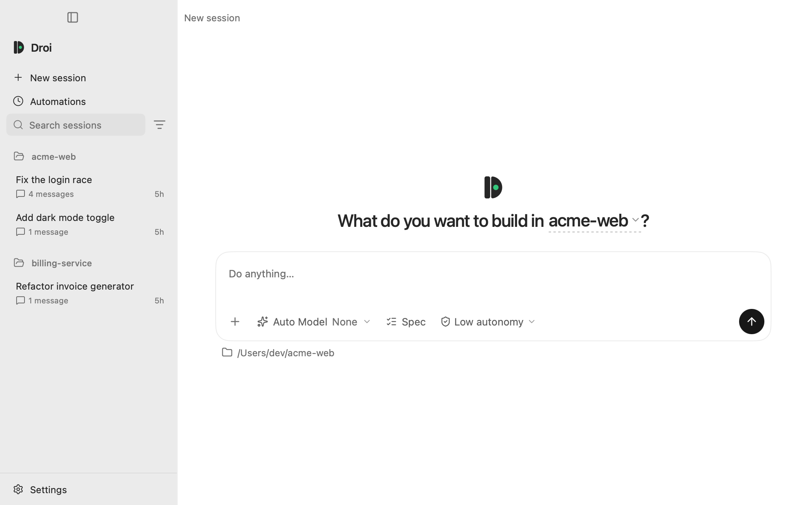
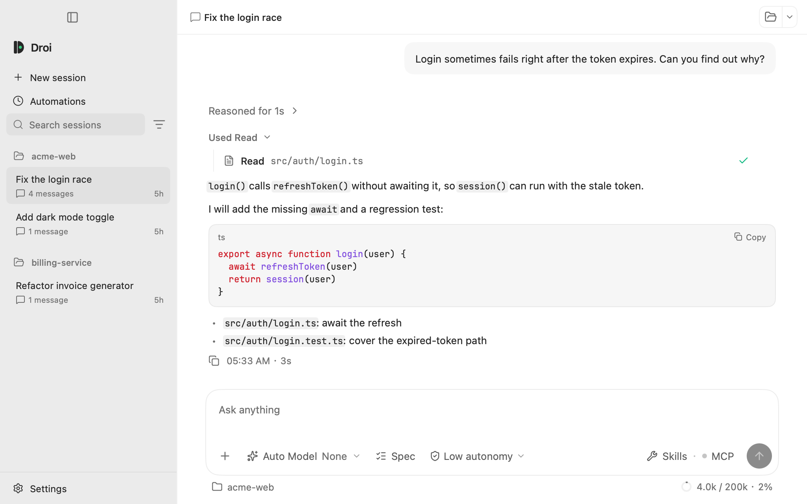
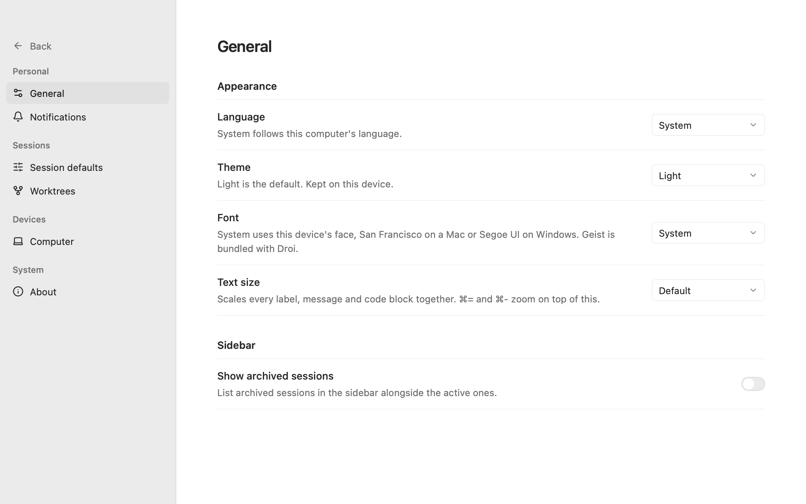

# PR #164 design comparison

The previous PR revision changed mainly tokens. This revision also changes the composition:
a grey navigation rail, compact Workspace and Session hierarchy, a centred New session composer,
inset conversation input and flat Settings groups. Existing controls and actions remain available.

| Surface | Previous PR revision | Current revision |
| --- | --- | --- |
| New session |  |  |
| Session |  |  |
| Settings |  |  |

Native screens are rendered by the real `App.View` against the Fake Daemon through the SDK in
MyGo's `ui.NewTester`, at 1024×640 points and 2× resolution. They cover the application surface;
OS window controls are not part of this capture. `before/` retains the original `main` screens.

| Native surface | Light | Dark | Solarized Light+ |
| --- | --- | --- | --- |
| Session | [View](after/session-light.png) | [View](after/session-dark.png) | [View](after/session-solarized-light.png) |
| New session | [View](after/new-session-light.png) | [View](after/new-session-dark.png) | [View](after/new-session-solarized-light.png) |
| Sign in | [View](after/signin-light.png) | [View](after/signin-dark.png) | [View](after/signin-solarized-light.png) |
| Settings, switch off | [View](after/settings-general-light.png) | [View](after/settings-general-dark.png) | [View](after/settings-general-solarized-light.png) |
| Settings, switch on | [View](after/settings-general-archived-light.png) | [View](after/settings-general-archived-dark.png) | [View](after/settings-general-archived-solarized-light.png) |
| Permission | [View](after/permission-light.png) | [View](after/permission-dark.png) | [View](after/permission-solarized-light.png) |
| AskUser | [View](after/ask-user-light.png) | [View](after/ask-user-dark.png) | [View](after/ask-user-solarized-light.png) |

[Short window, largest text, eight-line draft and image](after/new-session-short-largest.png):
the New session surface scrolls, and Start session remains reachable.

The Phone App screens use its web export at a 393×852 viewport against the Fake Daemon. They
show the same surface hierarchy with the existing 15px body text and touch targets. Hardware
and the software keyboard need an iPhone for verification.

| Phone surface | Light | Dark | Solarized Light+ |
| --- | --- | --- | --- |
| Session list | [View](after/phone-list-light.png) | [View](after/phone-list-dark.png) | [View](after/phone-list-solarized-light.png) |
| Transcript and code | [View](after/phone-transcript-light.png) | [View](after/phone-transcript-dark.png) | [View](after/phone-transcript-solarized-light.png) |
| Settings | [View](after/phone-settings-light.png) | [View](after/phone-settings-dark.png) | [View](after/phone-settings-solarized-light.png) |
